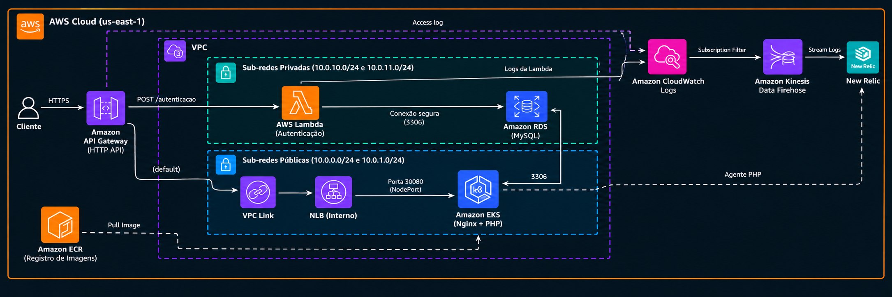

# FIAP Software Architecture Tech Challenge

[](https://sonarcloud.io/summary/new_code?id=oesleik_tech-chalange)
[](https://sonarcloud.io/summary/new_code?id=oesleik_tech-chalange)

API da oficina mecânica (clientes, veículos, peças, serviços, estoque e ordens de serviço). Este repositório tem o código PHP, o ambiente local (Docker Compose) e o chart Helm que publica a API no EKS.

A solução está dividida em quatro repositórios:

| Repositório | Papel |
|---|---|
| [tech-challenge-infra-k8s](https://github.com/oesleik/tech-challenge-infra-k8s) | VPC, EKS, ECR, API Gateway, New Relic |
| [tech-challenge-infra-db](https://github.com/oesleik/tech-challenge-infra-db) | Amazon RDS MySQL |
| **tech-chalange** (este) | Aplicação PHP (Helm no EKS) |
| [tech-challenge-lambda](https://github.com/oesleik/tech-challenge-lambda) | Lambda de autenticação (`POST /autenticacao`) |

A divisão e o contrato entre eles estão no [ADR-013](./docs/adr/013-divisao-repositorios.md).

## Tecnologias

- PHP 8.4 FPM, Slim Framework 4.x, Nginx
- MySQL 9 (local) / Amazon RDS MySQL (AWS)
- Docker Compose (desenvolvimento local) e Helm 3 (EKS)
- PHPUnit, php-cs-fixer, PHPStan, SonarCloud
- OpenTelemetry (local) e agente PHP do New Relic (EKS)
- GitHub Actions com OIDC

## Fases anteriores
- Documentos de entregas das fases anteriores em [docs/entregas/](./docs/entregas/)
- [Vídeo entrega fase 1](https://www.youtube.com/watch?v=ov2wa36pA7E)
- [Vídeo entrega fase 2](https://www.youtube.com/watch?v=xzyHejsCoEs)
- [Vídeo entrega fase 3]()

## 📋 Pré-requisitos

Ter o **Docker** e o **Docker Compose** instalados na máquina.

Para execução de comandos, também é necessário o **make**. No Windows, instale o projeto dentro do **WSL**. É possível rodar os comandos manualmente para não depender do make.

## 🚀 Como rodar

### 1. Configure o ambiente
```bash
# Configure o ambiente
cp .env.example .env
## Edite o .env se quiser alterar senhas ou nome do banco.

# Suba os containers
make up

# Execute as migrations
make migrate
```

#### Para desenvolvimento

Para ter o vendor local, funcionando com o intelisense da IDE:
```bash
mkdir -p vendor
docker compose cp php:/var/www/html/vendor/. ./vendor/

# Se erro de permissões
sudo chown -R "$(id -u):$(id -g)" vendor
```

Gerenciando dependências do composer:
```bash
# Entre no container
make shell

# Para instalar
composer require ...

# Para atualizar
composer update ...
```

## 🛠️ Comandos úteis

Vários comandos estão embutidos no Makefile, como rodar testes, lint, gerar token de autenticação, etc. Para visualizar todos os disponíveis, basta rodar:

```bash
make help
```

## 🌐 Acessos

| Serviço | Local | AWS |
|---|---|---|
| Aplicação | http://localhost | `<api_gateway_url>` |
| Health check | http://localhost/health | `<api_gateway_url>/health` |
| Swagger | http://localhost/docs/index.html | `<api_gateway_url>/docs/index.html` |
| Autenticação (Lambda) | — | `POST <api_gateway_url>/autenticacao` ([OpenAPI](https://github.com/oesleik/tech-challenge-lambda/blob/master/docs/openapi.yaml)) |
| phpMyAdmin | http://localhost:8080 | — |
| MySQL (externo) | localhost:3306 | — |

O `<api_gateway_url>` aparece no summary dos workflows de deploy (infra-k8s e este repositório).

**Credenciais do phpMyAdmin:**
- Usuário: `app_user`
- Senha: `secret`

## 🗂️ Estrutura do projeto

```
tech-chalange/
├── Dockerfile                  # Imagem PHP 8.4 FPM customizada
├── docker-compose.yml          # Orquestração dos containers
├── composer.json               # Dependências PHP (Slim 4)
├── .env                        # Variáveis de ambiente local (não versionar!)
├── .env.example                # Modelo do .env
├── docker/
│   ├── nginx/default.conf      # Configuração do Nginx
│   ├── php/php.ini             # Configurações customizadas do PHP
│   └── mysql/init/             # Scripts SQL executados na criação do banco
├── charts/tech-challenge/      # Helm da aplicação (EKS)
├── .github/workflows/          # CI, deploy e destroy
├── public/index.php            # Entry point da aplicação (Slim 4)
└── src/                        # Classes da aplicação (namespace App\)
```

## 🔐 Autenticação (JWT)

As rotas administrativas são protegidas por JWT. Gere um token manualmente:

```bash
make jwt-token
```

No [Swagger UI](http://localhost/docs/index.html), clique em **Authorize** 🔓 no topo da página e cole o token.

As rotas de aprovação e rejeição da ordem de serviço são protegidas por outro JWT, que é enviado via email. Para gerar manualmente:

```bash
make jwt-token-email
```
> Este token contem o id da ordem de serviço nos claims, o comando irá solicitar o id para a geração

## 🛡️ Análise de vulnerabilidades (OWASP ZAP)

O projeto utiliza o [OWASP ZAP](https://www.zaproxy.org/) para análise de segurança via scan de baseline. Não requer instalação, roda direto via Docker.

```bash
make security-scan
```

O scan roda o spider por ~1 minuto e faz análise passiva (sem ataques ativos), reportando problemas de headers de segurança, vazamento de informações, cookies, etc.

Os relatórios são gerados em `docs/security/`:
- `zap-baseline-report.html` — relatório visual (abra no navegador)
- `zap-baseline-report.json` — relatório em formato JSON

Para visualizar:

```bash
xdg-open docs/security/zap-baseline-report.html
```

## 📐 Documentação DDD

Os artefatos de modelagem do domínio (Domain Storytelling, Event Storming,
Domínios e Contextos Delimitados) estão em [`docs/ddd/`](./docs/ddd/README.md).

## 📐 Documentação sobre arquitetura

- **ADRs:** [`docs/adr/`](./docs/adr/README.md)
- **DAS:** [`docs/arch/DAS.md`](./docs/arch/DAS.md)

### Visão Geral da Solução

A aplicação segue **Clean Architecture** com separação entre **Domínio, Aplicação, Infraestrutura e Apresentação**. Cada módulo (Clientes, Veículos, Peças, Serviços, Estoque, OrdemServico) é independente, facilitando testes e manutenção.

#### Arquitetura por Módulo

Cada módulo segue a estrutura:

```
src/{Modulo}/
├── Domain/               # Regras de negócio
│   ├── Entity/           # Agregados
│   ├── ValueObject/      # CPF, Placa, etc
│   └── Exception/        # Erros do domínio
├── Application/          # Orquestração
│   ├── UseCase/          # {Acao}{Recurso}UseCase
│   ├── Gateway/          # Interfaces de persistência
│   └── DTO/              # Input/Output
├── Infrastructure/       # Implementações
│   └── Persistence/      # {Recurso}Gateway → MySQL
└── Presentation/         # HTTP
    └── Http/
        ├── Router/       # Definição de rotas
        ├── Controller/   # Entrada HTTP
        └── DTO/          # Mappers
```


### Arquitetura no EKS



## Deploy na AWS

Pré-requisitos: infra-k8s e infra-db já aplicados. O setup manual da conta (state, role OIDC `tech-challenge-gha-apply`) está no [runbook AWS](./docs/infrastructure/runbook_aws.md).

```
Deploy:  infra-k8s → infra-db → app → lambda
Destroy: lambda → app → infra-db → infra-k8s
```

**Actions → Deploy → Run workflow** (branch `master`). O [`deploy.yml`](.github/workflows/deploy.yml):

1. Lê o contrato SSM: `eks/cluster_name`, `ecr/php_repository_url`, `apigw/invoke_url` (infra-k8s) e `db/address`, `db/name` (infra-db). Se faltar algum, aborta dizendo qual repositório subir antes.
2. Faz build e push da imagem no ECR com a tag do commit.
3. Cria os Secrets `newrelic-license` e `rds-admin-secrets` (temporário) e roda `helm upgrade`.
4. Espera o job `rds-user-setup`, roda as migrations e confere o rollout do nginx.
5. Publica `/tech-challenge/app/image_tag`, que libera o deploy da Lambda e bloqueia o destroy do banco.

O **Destroy** ([`destroy.yml`](.github/workflows/destroy.yml)) exige que a Lambda já tenha saído, remove o release Helm e o namespace e apaga `/tech-challenge/app/*`.

### Variables e secrets

| Tipo | Nome | Uso |
|---|---|---|
| Variable | `AWS_ROLE_ARN_APPLY` | Role OIDC de deploy/destroy |
| Variable | `NEW_RELIC_ENTITY_GUID` | (opcional) Deployment marker no APM |
| Variable | `NEW_RELIC_REGION` | (opcional) `US` (padrão) ou `EU` |
| Secret | `DB_PASSWORD` | Senha do `app_user` |
| Secret | `DB_ROOT_PASSWORD` | Senha master do RDS, **igual** à do infra-db |
| Secret | `LAMBDA_DB_PASSWORD` | Senha do usuário `autenticacao`, **igual** à do repo lambda |
| Secret | `JWT_SECRET` | Assinatura do JWT, **igual** à do repo lambda |
| Secret | `OS_EMAIL_ACTION_TOKEN_SECRET` | Token dos links de aprovação por e-mail |
| Secret | `MAIL_USERNAME`, `MAIL_PASSWORD` | (opcional) SMTP |
| Secret | `NEW_RELIC_LICENSE_KEY` | Agente PHP do New Relic |
| Secret | `NEW_RELIC_API_KEY` | (opcional) Deployment marker |
| Secret | `SONAR_TOKEN`, `SONAR_PROJECT_KEY`, `SONAR_ORGANIZATION` | (opcional) SonarCloud no CI |

Os secrets marcados como **igual** ficam duplicados entre repositórios. Se divergirem, o erro só aparece em runtime (job `rds-user-setup` falha, token rejeitado com 401 ou Lambda sem acesso ao banco).

### CI

O [`ci.yml`](.github/workflows/ci.yml) roda em PR e em push na `master`: lint (php-cs-fixer), SAST (PHPStan), testes com cobertura (+ SonarCloud) e validação do chart (`helm lint` e `helm template` com os values da AWS). Nenhum job usa credenciais AWS.

## 📊 Documentação sobre observabilidade

A solução de observabilidade local com **OpenTelemetry, Prometheus, Grafana, Loki e Jaeger** está documentada em [`docs/observability/observabilidade.md`](./docs/observability/observabilidade.md).

O New Relic no EKS está em [`docs/observability/newrelic.md`](./docs/observability/newrelic.md).

Para subir o ambiente:

```bash
make otel-up
```

Principais interfaces locais:

- **Grafana:** http://localhost:3000
- **Prometheus:** http://localhost:9090
- **Jaeger:** http://localhost:16686

## Operação AWS

Para operar o ambiente AWS completo (os quatro repositórios), consulte:

- **[Guia operacional de deploy, validação e destroy na AWS](./docs/infrastructure/deploy_aws.md)** — procedimento recorrente pelo GitHub Actions, comandos de validação, troubleshooting e remoção para evitar custos.
- **[Runbook AWS](./docs/infrastructure/runbook_aws.md)** — configuração inicial do state remoto do Terraform, OIDC/IAM e variables/secrets do GitHub Actions.
