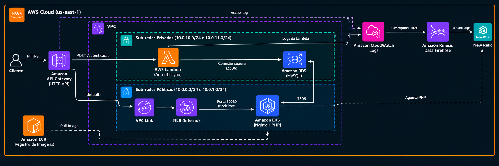

# Arquitetura do projeto

O [DAS (Design Approval Sheet)](./DAS.md) lista as decisões e componentes principais do projeto.

O [User Story](./User_Story.MD) descreve os objetivos e fluxos do negócio.

## Diagramas e modelo de dados

- [Arquitetura consolidada, sequências de autenticação e abertura de OS, ERD e justificativa do MySQL](./architecture.md)
- [RFCs - propostas e alternativas técnicas](../rfc/README.md)
- [ADRs - decisões arquiteturais](../adr/README.md)

O ERD em `architecture.md` reflete as migrations atuais. O arquivo legado [`dbml.png`](./dbml.png) ainda apresenta `veiculo_cliente`, tabela que não existe nas migrations, e não deve ser usado como referência do schema atual até ser regenerado.

Os diagramas [`C4_C1-contexto.png`](./C4_C1-contexto.png), [`C4_C2-container-api-server.png`](./C4_C2-container-api-server.png) e [`HLD.png`](./HLD.png) descrevem uma visão anterior/local da aplicação. Para uma apresentação da arquitetura AWS atual, use `architecture.md` e `AWS-Architecture.png`; se os diagramas C4/HLD forem mantidos como visão atual, devem ser atualizados para incluir API Gateway, Lambda, RDS, EKS, New Relic e HPA.

## Arquitetura na AWS

O diagrama AWS é uma visão de infraestrutura. Consulte `architecture.md` para limites dos componentes, HPA e fluxo de autenticação.
