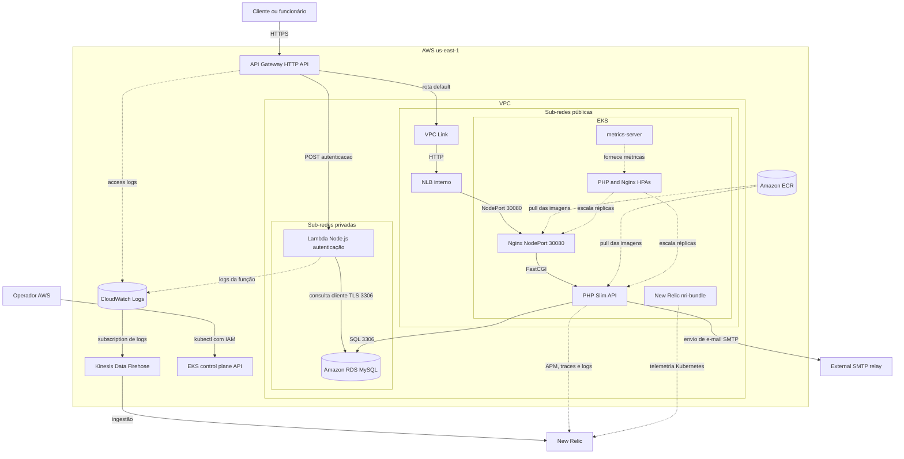
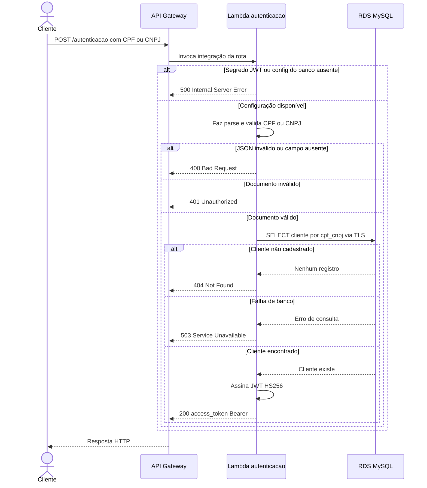
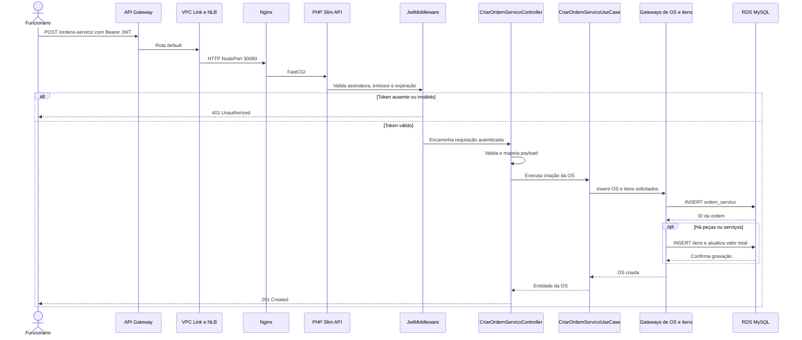
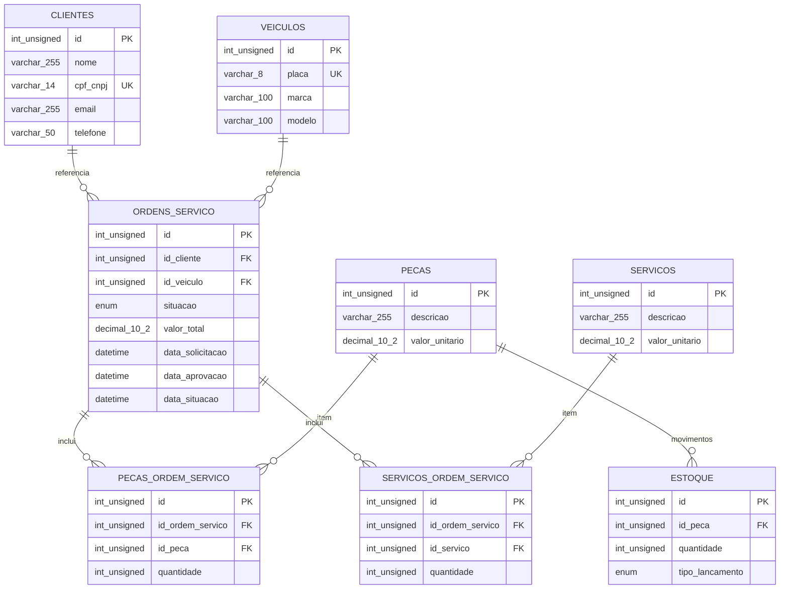

# Arquitetura e modelo de dados

Este documento consolida a arquitetura configurada no projeto e os fluxos de autenticação e abertura de ordens de serviço. Os diagramas usam os contratos, as rotas, as migrations e a infraestrutura como código disponíveis neste workspace; recomendações de evolução estão identificadas como propostas, não como comportamento já implementado.

## Diagrama de componentes

O diagrama representa a entrada pública, os caminhos de autenticação e da API PHP, a persistência e a observabilidade AWS. A topologia específica de redes e recursos está detalhada no [diagrama AWS](./AWS-Architecture.png); este diagrama acrescenta os limites de aplicação e o HPA.

<!-- mermaid-checked: no \n, no em-dash/en-dash, no {} in labels, subgraphs are id["label"], arrows are -->|"label"|, all subgraphs closed by end, ids unique -->

### Fluxos e limites

- `POST /autenticacao` é uma rota específica do API Gateway integrada à Lambda. A função valida CPF/CNPJ, consulta `clientes` no RDS e emite um JWT HS256.
- As demais rotas seguem a rota `$default`: API Gateway → VPC Link → NLB interno → Nginx → PHP. O middleware PHP valida o JWT; o API Gateway não atua como autorizador.
- A aplicação PHP e a Lambda acessam o mesmo RDS. A Lambda consulta a tabela `clientes` com credencial de leitura; a aplicação executa as operações da oficina.
- Os logs do API Gateway e da Lambda passam pelo CloudWatch; o pipeline New Relic também recebe logs e telemetria do cluster conforme a configuração da plataforma.
- O HPA escala réplicas de pods, não nós EKS. O node group declarado no Terraform tem limites configurados separadamente.
- O endpoint de gerenciamento do control plane EKS está configurado como público (`endpoint_public_access = true`, `endpoint_private_access = false`), sem lista de restrição por CIDR declarada no recurso Terraform. É distinto do endpoint público da aplicação e merece revisão de acesso antes de produção.

## Sequência de autenticação

Implementação correspondente à Lambda `POST /autenticacao`, à consulta de existência de cliente e à geração do token. Requisições autenticadas subsequentes usam o fluxo de abertura de OS abaixo.

<!-- mermaid-checked: no \n, no em-dash/en-dash, no {} in labels, subgraphs are id["label"], arrows are -->|"label"|, all subgraphs closed by end, ids unique -->

## Sequência de abertura de ordem de serviço

O projeto já possuía o diagrama detalhado [LLD de criação de OS](./LLD_criacao_ordem_servico.png). Esta versão compacta explicita também a entrada AWS e corresponde ao `POST /ordens-servico/` protegido pelo middleware JWT. O controller devolve `201 Created`; a gravação da OS e dos itens é realizada pelos gateways MySQL.

<!-- mermaid-checked: no \n, no em-dash/en-dash, no {} in labels, subgraphs are id["label"], arrows are -->|"label"|, all subgraphs closed by end, ids unique -->

O registro da OS e a persistência de itens são chamadas separadas no caso de uso. Os gateways de itens usam transações para as operações de adição/substituição de cada tipo de item; o caso de uso não envolve toda a criação em uma única transação global.

## Modelo relacional e justificativa do banco

O ER abaixo espelha as migrations presentes. Ele substitui, para fins de referência do schema atual, o desenho antigo em [`dbml.png`](./dbml.png), que contém a tabela `veiculo_cliente` ausente das migrations.

<!-- mermaid-checked: no \n, no em-dash/en-dash, no {} in labels, subgraphs are id["label"], arrows are -->|"label"|, all subgraphs closed by end, ids unique -->

### Relacionamentos e observações do schema atual

- No diagrama, `int_unsigned` representa SQL `INT UNSIGNED` e `decimal_10_2` representa `DECIMAL(10,2)`.
- Um cliente pode estar associado a várias OS; cada OS referencia um cliente e um veículo.
- Um veículo pode aparecer em várias OS. As migrations não criam um relacionamento direto de propriedade entre veículo e cliente; a OS guarda ambos os IDs, sem constraint que garanta que o cliente seja proprietário do veículo.
- `PECAS_ORDEM_SERVICO` e `SERVICOS_ORDEM_SERVICO` resolvem os relacionamentos muitos-para-muitos entre OS e catálogo, com quantidade em cada linha.
- `ESTOQUE` referencia uma peça e registra quantidade e tipo (`entrada`/`baixa`). O schema atual não registra data do movimento nem associa a baixa a uma OS.
- Os itens de OS não armazenam o preço unitário aplicado no momento da inclusão. O total é calculado a partir dos preços atuais de catálogo; alterações futuras de preço podem afetar a reprodução histórica do orçamento.
- `valor_unitario` e `valor_total` são `DECIMAL(10,2)` nas migrations; não devem ser representados como `FLOAT` ou `DOUBLE` no ER.

### Por que MySQL

MySQL atende ao modelo transacional e relacional existente: chaves estrangeiras protegem vínculos entre clientes, veículos, ordens, catálogo e itens; transações são usadas nas operações de persistência de itens; e consultas SQL suportam os filtros e relatórios da aplicação. Também mantém uma tecnologia consistente entre desenvolvimento local em Docker e produção no Amazon RDS.

A escolha do RDS desacopla o ciclo de vida do banco dos pods e fornece armazenamento gerenciado e criptografado. **A implantação atual é Single-AZ, com backups automatizados desabilitados e sem snapshot final automático**, portanto não deve ser descrita como configuração de alta disponibilidade ou recuperação garantida. Essa escolha e seus trade-offs estão detalhados nos [ADRs 001 e 007](../adr/README.md).

### Ajustes de modelo a decidir antes de alterar migrations

1. **Propriedade de veículo:** decidir se é necessária. Se sim, substituir a tabela de associação desatualizada por uma FK em `veiculos` (propriedade única) ou uma tabela de histórico/associação com vigência (propriedade múltipla), e validar que a OS só aceite veículo associado ao cliente informado.
2. **Histórico de preços:** se o orçamento aprovado precisar permanecer imutável, salvar o preço unitário aplicado e descrição relevante em cada item da OS; calcular o total a partir desses snapshots.
3. **Auditoria do estoque:** se for necessário rastrear quando e por que cada movimento ocorreu, incluir data e referência opcional à OS, mantendo a peça como FK.

Esses três pontos são recomendações de evolução do modelo, não mudanças implementadas nas migrations atuais.

## RFCs e ADRs

- [RFC-001 - Plataforma de nuvem](../rfc/001-plataforma-nuvem.md) → [ADR-011 - AWS](../adr/011-aws.md)
- [RFC-002 - Banco relacional e modelo de dados](../rfc/002-banco-e-modelo-relacional.md) → [ADRs 001 e 007 - MySQL e RDS](../adr/README.md)
- [RFC-003 - Autenticação e comunicação das APIs](../rfc/003-autenticacao-e-comunicacao.md) → [ADRs 008 e 010 - Lambda e API Gateway](../adr/README.md)
- Outros [ADRs aceitos](../adr/README.md), incluindo HPA, observabilidade e divisão dos repositórios.
