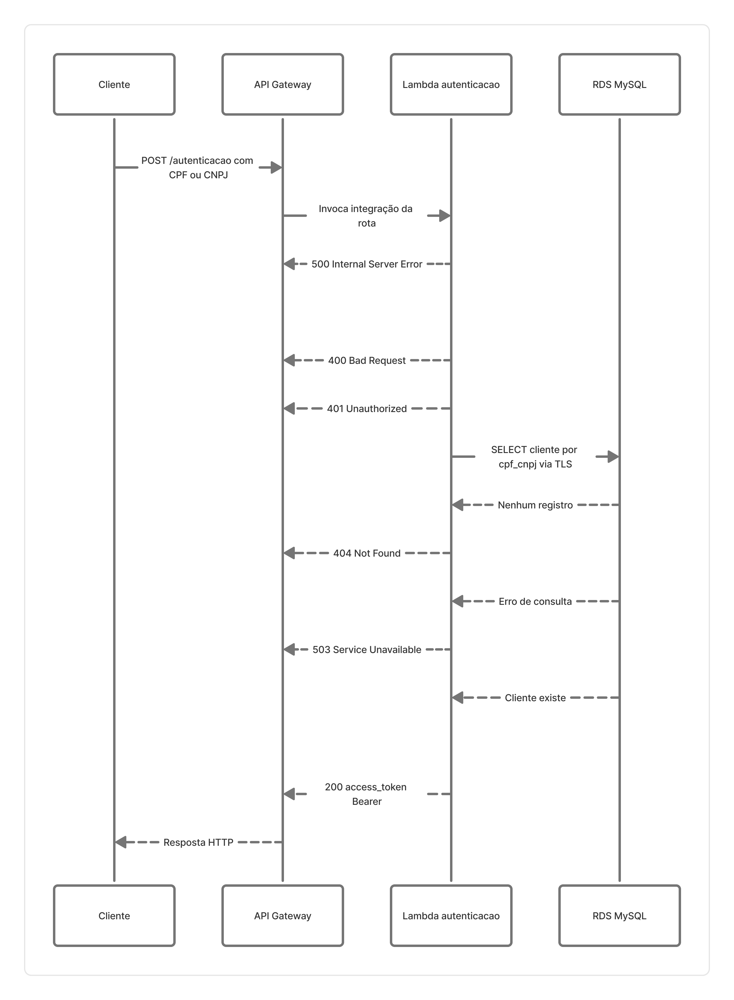

# Fluxo de Autenticação

Este documento descreve o fluxo de autenticação de clientes via API Gateway e AWS Lambda, documentando a validação de documento (CPF ou CNPJ), a verificação de cadastro no banco de dados (RDS MySQL) e a geração do token JWT.

## Passo a passo do fluxo

### 1. Requisição do cliente
O cliente envia uma requisição `POST /autenticacao` para o API Gateway contendo o documento (`cpf` ou `cnpj`) no corpo da requisição em formato JSON.

### 2. Roteamento pelo API Gateway
O API Gateway identifica a rota `/autenticacao` e aciona a integração correspondente, repassando o evento para a função AWS Lambda de autenticação.

### 3. Validação de configuração do ambiente
A Lambda valida se as variáveis de ambiente essenciais (como segredo do JWT e parâmetros de conexão ao banco) estão configuradas.
- **Erro de configuração (HTTP 500 - Internal Server Error):** Caso falte alguma configuração essencial, a Lambda retorna erro 500 antes de prosseguir.

### 4. Validação de formato e regras do documento
A Lambda processa o payload recebido e aplica as regras de validação:
- **JSON malformado ou campos ausentes (HTTP 400 - Bad Request):** Retornado se o corpo da requisição for inválido ou não contiver CPF/CNPJ.
- **Documento com dígito verificador ou formato inválido (HTTP 401 - Unauthorized):** Retornado se o documento falhar na checagem dos dígitos verificadores (CPF/CNPJ).

### 5. Consulta ao banco de dados (RDS MySQL)
Com o documento validado, a Lambda conecta-se via TLS (porta 3306) ao RDS MySQL em sub-rede privada e executa uma consulta (`SELECT`) na tabela `clientes` buscando pelo CPF ou CNPJ informado.
- **Cliente não cadastrado (HTTP 404 - Not Found):** Se a consulta não retornar nenhum registro, a Lambda encerra o fluxo informando que o cliente não foi encontrado.
- **Falha de conectividade ou erro de banco (HTTP 503 - Service Unavailable):** Caso ocorra timeout, indisponibilidade ou erro na consulta ao RDS, a Lambda retorna erro 503.

### 6. Emissão do token JWT e retorno de sucesso
- **Cliente existente (HTTP 200 - OK):** Se o cliente for localizado com sucesso, a Lambda assina um token JWT (algoritmo HS256) com tempo de expiração e dados de identificação do cliente.
- A Lambda retorna o status 200 contendo o token no payload.

### 7. Resposta HTTP ao cliente
O API Gateway repassa a resposta HTTP da Lambda de volta para o cliente, que utilizará o token JWT no cabeçalho Authorization para interagir com os endpoints protegidos da API PHP.
