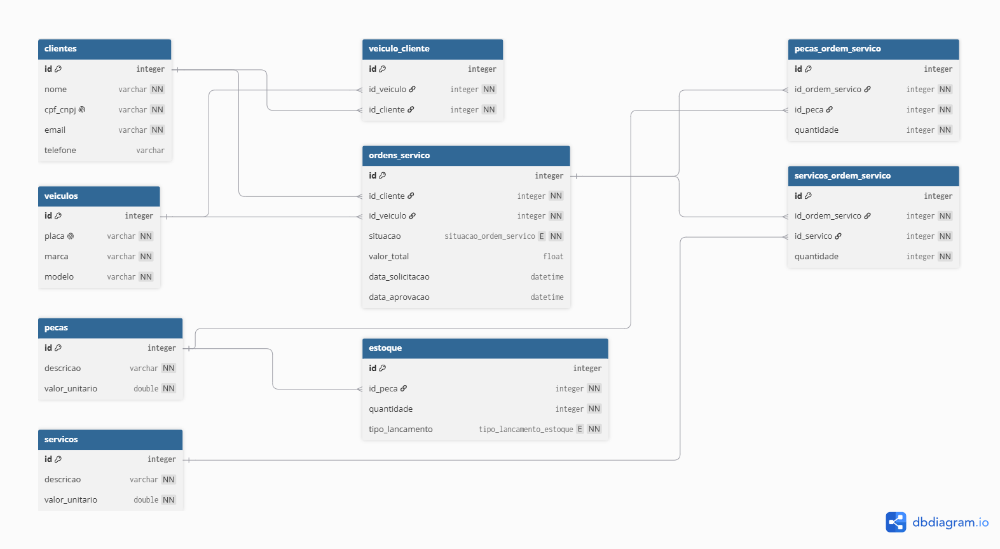

# Modelo relacional

A escolha do MySQL e do Amazon RDS está registrada nas [ADR-001](../adr/001-banco-dados.md) e [ADR-007](../adr/007-rds-mysql.md), com alternativas e trade-offs na [RFC-002](../rfc/002-banco-e-modelo-relacional.md). Este documento complementa essas decisões com o diagrama e os relacionamentos do schema implementado.

## Diagrama ER

> **Atenção:** `dbml.png` é um diagrama legado. Ele inclui `veiculo_cliente`, que não existe nas migrations atuais, e não reflete os campos de preço das tabelas de itens. Consulte as migrations como fonte do schema implementado.

## Relacionamentos no schema implementado

- **Cliente 1:N Ordens de Serviço:** cada OS referencia um cliente por `id_cliente`; um cliente pode estar associado a várias OS.
- **Veículo 1:N Ordens de Serviço:** cada OS referencia um veículo por `id_veiculo`; um veículo pode estar associado a várias OS. As migrations não definem uma relação direta nem uma tabela de associação entre cliente e veículo.
- **Ordens de Serviço N:N Peças:** `pecas_ordem_servico` associa OS e peças, registrando a quantidade usada.
- **Ordens de Serviço N:N Serviços:** `servicos_ordem_servico` associa OS e serviços, registrando a quantidade.
- **Peças 1:N Estoque:** `estoque` registra lançamentos de entrada ou baixa associados a uma peça. A tabela não referencia diretamente uma OS.

As tabelas de associação de peças e serviços não guardam o preço unitário praticado na OS; os valores permanecem no cadastro de peças/serviços. Portanto, as migrations atuais não implementam snapshot histórico desses preços.
