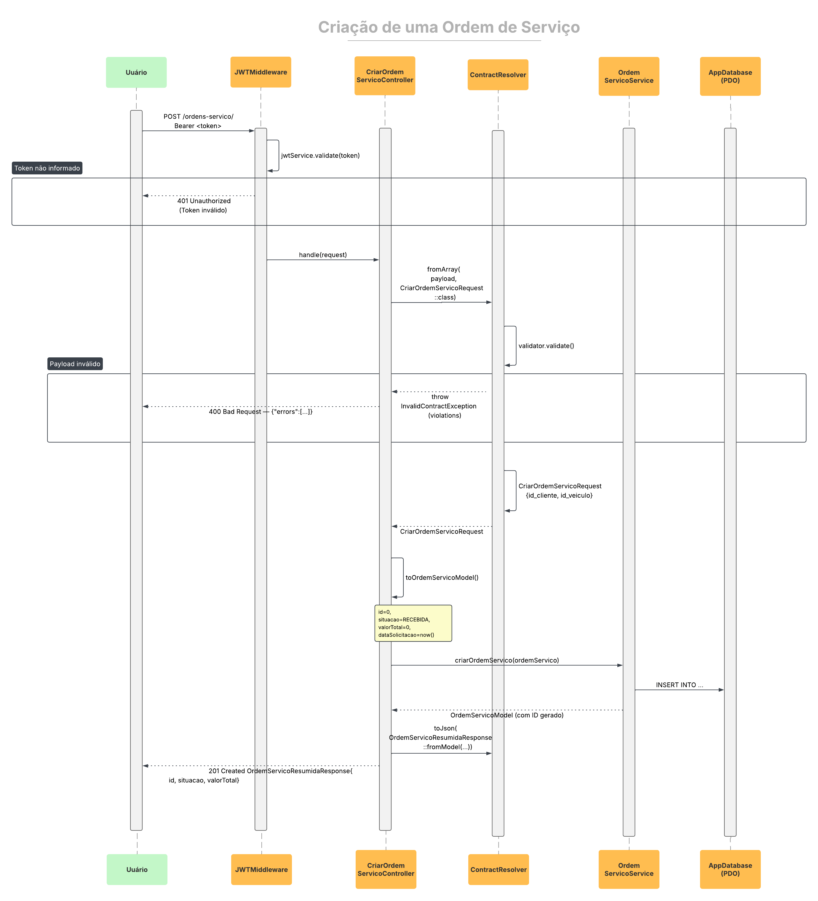

# Fluxo de Abertura de Ordem de Serviço

Este documento descreve a sequência de abertura de uma nova Ordem de Serviço (OS) através da rota `POST /ordens-servico/`, detalhando o trajeto da requisição na infraestrutura em nuvem (AWS API Gateway, VPC Link, NLB interno e cluster EKS), a validação de autorização via middleware JWT, as camadas de aplicação (Clean Architecture) e a persistência no Amazon RDS MySQL.

## Passo a passo do fluxo

### 1. Requisição do funcionário
O funcionário autenticado envia uma requisição `POST /ordens-servico/` contendo:
- Cabeçalho `Authorization: Bearer <token_jwt>` gerado previamente no fluxo de autenticação.
- Corpo da requisição em JSON especificando o cliente (`cliente_id`), o veículo (`veiculo_id`) e as listas opcionais de peças (`pecas`) e serviços (`servicos`) a serem executados.

### 2. Entrada e roteamento na infraestrutura de nuvem (AWS)
1. **API Gateway (HTTP API):** A requisição pública atinge o endpoint seguro da AWS e é capturada pela rota padrão (`$default`).
2. **VPC Link & NLB interno:** O tráfego privado é encaminhado através do VPC Link para o Network Load Balancer (NLB) interno na VPC.
3. **Cluster EKS (Nginx):** O NLB direciona a requisição para os pods do Nginx rodando em NodePort 30080.
4. **FastCGI para PHP-FPM:** O Nginx realiza o proxy reverso via FastCGI para os pods da aplicação PHP Slim.

### 3. Validação de autenticação (`JwtMiddleware`)
Antes de alcançar os controladores de domínio, a requisição passa pelo middleware de segurança do PHP:
- Valida a assinatura do token JWT com o algoritmo HS256, a integridade das claims, o emissor e a data de expiração.
- Caso o token esteja ausente, expirado ou com assinatura inválida, o middleware encerra a requisição retornando `401 Unauthorized`.
- Se o token for válido, a requisição autenticada é liberada para a camada de apresentação.

### 4. Camada de Apresentação (`CriarOrdemServicoController`)
- O controller recebe a requisição HTTP autenticada.
- Valida os dados de entrada contra as regras de contrato utilizando o Symfony Validator.
- Converte o payload HTTP em um DTO de entrada e aciona o caso de uso correspondente.

### 5. Camada de Aplicação (`CriarOrdemServicoUseCase`)
- O caso de uso orquestra a lógica de negócio para a criação da OS:
  - Valida a existência do cliente e do veículo no sistema.
  - Instancia a entidade de domínio `OrdemServico` com o status inicial definido como `RECEBIDA`.
  - Aciona os gateways de dados para gravação no banco.

### 6. Persistência de dados (Gateways e RDS MySQL)
1. **Inserção da Ordem:** O `OrdemServicoGateway` executa o `INSERT` na tabela `ordens_servico` no RDS MySQL e recupera o identificador (`id`) gerado.
2. **Gravação de Itens (Peças e Serviços):**
   - Caso itens de peças tenham sido enviados, o `PecaOrdemServicoGateway` insere os registros na tabela `pecas_ordem_servico`.
   - Caso serviços tenham sido informados, o `ServicoOrdemServicoGateway` insere os registros na tabela `servicos_ordem_servico`.
   - O valor total da ordem é consolidado e atualizado no banco de dados.

### 7. Resposta HTTP de Sucesso
- O caso de uso retorna a entidade da Ordem de Serviço criada para o controller.
- O controller formata a resposta JSON com o identificador da OS e seus dados cadastrados.
- É retornado o código de status HTTP `201 Created` para o cliente.
